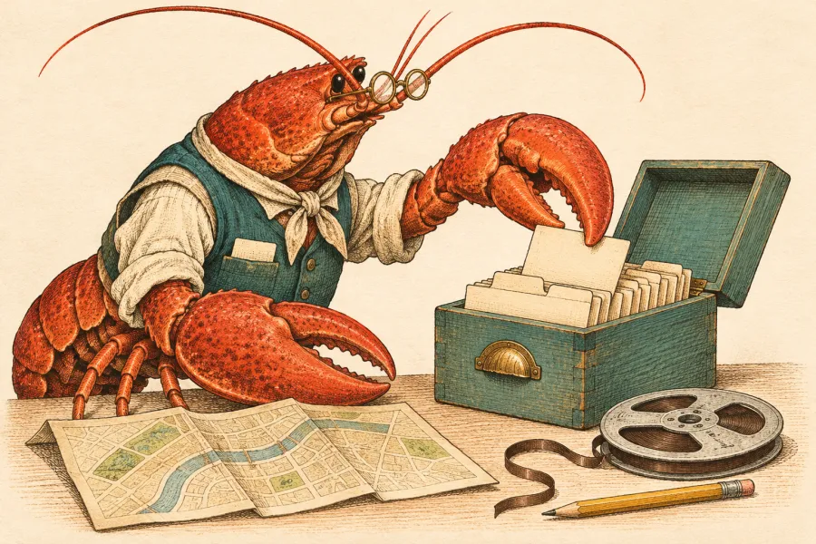

# Drawing for Shelldex

The [Ideas recipe-box illustration](../public/images/ideas-recipe-box.webp) is the master. Open it next to the finished work. Attach that file to every new commission; using a previous derivative as the reference lets small differences accumulate.

## What makes it recognizable

- **Character.** The long antennae, bead eye, pointed snout, unequal claws and mottled shell are lobster anatomy. Round brass spectacles, a teal waistcoat, rolled ecru sleeves and a neckerchief identify the archivist. Show concentration through the work and the tilt of the head.
- **Drawing.** Fine sepia contours and curved crosshatching describe volume. Stipple the shell; let parallel lines follow the linen, wood and painted metal. Translucent washes let the ivory paper through. A chunky two-color linocut loses this distinction between materials.
- **Color.** Warm ivory paper supplies the highlights. Vermilion and burnt sienna belong to the shell; weathered teal, ochre brass and local umber shadows carry the rest of the plate.
- **Composition.** Give each page its own subject, viewpoint and silhouette. Use the master for its drawing technique and materials. The lobster represents the agent. For guides about using or choosing an agent, show its claw acting on the input, device or result that readers will use in the exercise. A close-up of a claw can carry the scene. Captions should tell the reader what they can check in that example. For a thumbnail, omit the character, carry over the materials, and give the object a clear outline. Put explanations in HTML. Use a short, legible screen label or number when the reader needs it to understand the result.
- **Scope.** Apply this style to editorial illustrations and their social previews. Navigation symbols, logos, repository identities and charts have different jobs; keep them legible and accurate.

## Prompt set

Use the built-in image generator with the original recipe-box WebP attached. Start a character scene with this brief:

> Paint a companion plate from the same late-nineteenth-century hand-coloured natural-history book as the reference. Fine brown copperplate contour, stippled shell pores, fine curved crosshatches, translucent vermilion and sienna watercolour, muted patinated teal, warm mottled ivory stock, aged brass fittings, soft directional shadow. Match the archivist’s real lobster head, feelers, bead eye, unequal claws, brass spectacles, teal waistcoat, cream linen sleeves and neckerchief. Alert and absorbed in the task. No hat, cartoon smile, heavy linocut marks, flat duotone, glossy 3D, text, frame or watermark.

| Placement | Scene to append |
| --- | --- |
| Homepage and default share card | Wide 2:1. At a tide table the archivist sorts three distinct shell specimens beside a notebook; a little shore beyond. Keep spectacles, antennae and shells inside the crop. |
| FAQ | Overhead close-up of a lobster claw using a stylus to tick a digital checklist while its other claw holds two quotes. |
| Alternatives overview | Two lobster agents return the same $48 invoice total on a split screen. One links to page 2, allowing the reader to verify it. |
| Hermes alternatives | The agent shows a Celsius forecast in a fresh chat after the user set that preference. |
| OpenFang alternatives | A claw follows a report citation to the official documentation before scheduling a repeat run. |
| Secure OpenClaw alternatives | A lobster types a reply to a sample invitation on a phone. The reply is visibly a draft. |

For the smaller illustrations, use this brief with the same reference:

> Draw one object study from the same hand-coloured natural-history engraving. Study the reference’s teal index box, brass fitting, map and reel. Describe the object with hairline sepia etched contours, fine directional crosshatching and translucent watercolour on softly mottled ivory paper. Teal paint, shell vermilion details, antique brass. One centered group with a grounded shadow and clear paper margins, landscape 3:2. Recognizable at 48 pixels. No lobster, labels, frame, flat icon or block-print.

| Use | Object |
| --- | --- |
| At my desk | An open laptop at three-quarter view, with a spiral shell on screen |
| Always on | A small teal server with ventilation slots on a wooden shelf |
| In a chat app | Two overlapping paper speech balloons, vermilion and teal |
| Tiny hardware | A single-board computer with brass pins, beside a cockleshell for scale |
| Hosted | A freestanding cabinet of stacked servers, visually distinct from the home machine |
| Files | A teal expanding document folder with cream tabbed files |
| Recurring briefing | An upright twin-bell alarm clock with brass fittings |
| Phone | A modern phone in a teal case, one vermilion message balloon on screen |
| Own model | One microprocessor, contacts on four sides, no surrounding board |

## Delivery

Keep the original Ideas plate intact. The [homepage assets](../public/images/home/), [Alternatives plates](../public/images/plates/), [FAQ and sharing assets](../public/images/) are exported web sizes. FAQ and About share a single three-host strip. Keep existing public image URLs working when replacing art.

Compare the head and claws directly with the master. Inspect one cuff, brass fitting or shell ridge at full scale. Then check the real placement: the phone crop should still show the action, a small study should read without its label, and a share card should retain the subject at 1200 × 630. Record future subject briefs here.
